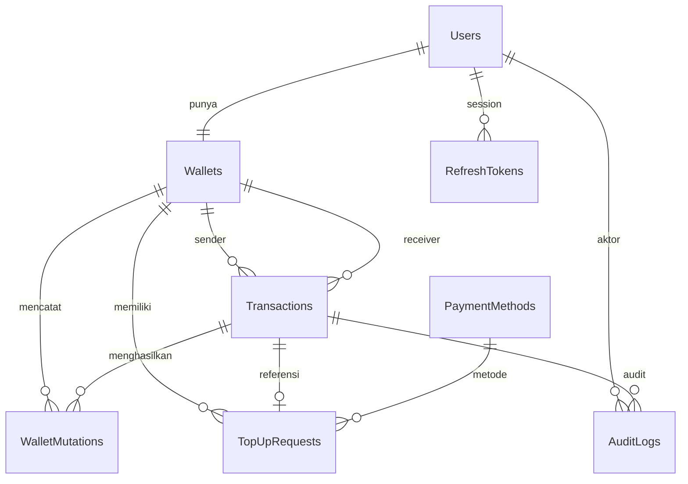

# KodaWallet - E-Wallet Platform (Fullstack)

Proyek ini adalah kelanjutan dari e-wallet sebelumnya, yang sekarang sudah berkembang jadi aplikasi fullstack: backend REST API berbasis **ASP.NET Core (.NET 10)** dengan **Clean Architecture**, dan frontend web SPA berbasis **React (Vite + Tailwind CSS)**.

Tujuan utama di weekly ini adalah memisahkan tanggung jawab kode secara modular (Domain, Application, Infrastructure, API), mengimplementasikan sistem autentikasi & autorisasi berbasis Identity dan JWT (dengan refresh token rotation & rate limiting), serta menyambungkan antarmuka React secara langsung ke API nyata tanpa dummy data lagi.

---

## Arsitektur & Struktur Proyek

Project backend dibagi ke dalam layer Clean Architecture agar domain logic tidak terikat langsung ke database framework maupun Web API framework.

```
├── src/
│   ├── Ewallet.Domain/           # Entities inti, value objects, enum
│   ├── Ewallet.Application/      # DTOs, interface repository/service, core use cases
│   ├── Ewallet.Infrastructure/   # Implementasi EF Core, Identity, JWT, Repositories
│   └── Ewallet.Api/              # Controllers, middlewares, program setup, rate limiting
│
├── react/                        # Frontend React + Vite
│   ├── src/
│   │   ├── context/              # AuthContext (state user, session, permissions)
│   │   ├── lib/                  # api.js (fetch client wrapper + auto refresh token)
│   │   ├── components/           # UI components, layout items, ProtectedRoute
│   │   ├── layouts/              # WalletLayout (customer) & AdminLayout (admin)
│   │   └── pages/                # Customer pages & Admin pages
│
└── tests/
    └── Ewallet.Tests/            # Unit / integration tests
```

### Kenapa dibagi seperti ini?

1. **Ewallet.Domain**: 
   - Berisi entity inti (`Wallet`, `Transaction`, `WalletMutation`, `TopUpRequest`, `AuditLog`) dan enum.
   - Tidak punya dependency ke project mana pun. Menjamin aturan bisnis dasar tidak mudah terkontaminasi urusan HTTP atau ORM.
2. **Ewallet.Application**:
   - Berisi DTO, kontrak repository (`IWalletRepository`, `IUserRepository`, dll.), dan logika transaksi bisnis (`WalletService`, `TransferService`, `TopUpService`).
   - Hanya bergantung ke `Domain`. Jika suatu hari data source diganti dari EF Core ke mekanisme lain, use case bisnis tidak perlu ditulis ulang.
3. **Ewallet.Infrastructure**:
   - Tempat semua detail teknis: konfigurasi Entity Framework Core (`AppDbContext`), ASP.NET Core Identity (`ApplicationUser`), implementasi JWT generator, refresh token family rotation, dan repositori konkrit.
   - Menghubungkan interface `Application` dengan database SQL Server.
4. **Ewallet.Api**:
   - Menangani layer HTTP: routing controller, request validation, global exception middleware, CORS, dan rate limiter.
5. **React Frontend**:
   - Menggunakan model single-page application (SPA) yang bersih dengan React Router. State auth dan izin hak akses diletakkan terpusat di `AuthContext`, sementara `api.js` mengisolasi semua urusan headers, token JWT, dan auto-refresh.

---

## Keputusan Desain & Alasan Teknis

### 1. Model Transaksi: `Transactions` vs `WalletMutations` vs `AuditLogs`
- **Transactions**: Menyimpan data transaksi di level bisnis (apakah Top Up atau Transfer, dari wallet mana ke wallet mana, nominal, dan statusnya).
- **WalletMutations**: Mencatat buku besar (ledger) saldo per wallet secara historis. Untuk transfer antar wallet, dibuat 2 mutasi (`OUT` pada pengirim dan `IN` pada penerima) lengkap dengan saldo sebelum dan sesudahnya. Ini memudahkan audit keuangan jika suatu saat saldo tidak balance.
- **AuditLogs**: Mencatat rekam jejak aksi pengguna dan sistem (termasuk aksi yang ditolak/gagal). Audit log dibuat terpisah agar kegagalan operasi tetap bisa terdokumentasi tanpa membatalkan transaksi log audit itu sendiri (`RecordIndependentAsync`).

### 2. Concurrency Control dengan `RowVersion`
Operasi dompet digital rentan terhadap *race condition* (misalnya pengguna mengklik transfer 2 kali dalam milidetik yang sama). 
- Di entity `Wallet`, kami memasang token concurrency berbasis `byte[]` (`RowVersion` di SQL Server).
- Saat ada update bersamaan yang konflik, EF Core akan mendeteksi `DbUpdateConcurrencyException`, yang kemudian diterjemahkan oleh middleware menjadi status `409 Conflict`. Saldo tidak akan pernah bertambah/berkurang dua kali tanpa sinkronisasi yang valid.

### 3. Database Transaction & Atomic Operations
- Di method kritis seperti konfirmasi top up dan transfer dana, kami menggunakan `IDbTransaction` / EF Core execution strategy.
- Seluruh mutasi saldo, insert histori transaksi, pembuatan mutasi saldo, dan pencatatan audit log harus berhasil bersama-sama. Jika terjadi error di tengah jalan, seluruh perubahan di-rollback secara otomatis.

### 4. Autentikasi: JWT Access Token + Refresh Token Family
- **Access Token (JWT)** dibuat berumur pendek untuk keamanan.
- **Refresh Token** disimpan di database dengan pengelompokan `FamilyId`. Kami menerapkan **Refresh Token Rotation**: setiap kali token di-refresh, token lama di-revoke dan token baru diterbitkan. Jika ada indikasi penggunaan token yang sudah di-revoke (potensi token theft), seluruh keluarga token terkait otomatis dicabut.
- **Auto-Refresh di Frontend (`src/lib/api.js`)**: Saat request biasa menerima HTTP `401 Unauthorized`, interceptor frontend otomatis memanggil `POST /api/auth/refresh` di belakang layar, memperbarui token di storage, lalu mengulang kembali request asli tanpa memaksa user logout.

### 5. Role & Permission-based Authorization
- Pengguna dibedakan lewat peran Identity (`CUSTOMER` dan `ADMIN`).
- Backend memvalidasi hak akses menggunakan custom claim policy (`ClaimPolicyProvider`), misalnya policy `users.manage`, `wallet.transact`, atau `auditlogs.read`.
- Di frontend, komponen `ProtectedRoute` menjaga agar halaman pengguna biasa terlindungi dari tamu yang belum login, dan rute `/admin/*` hanya bisa dimasuki user yang memiliki role `ADMIN`. Bila user tanpa role admin memaksa masuk, mereka diarahkan ke halaman `/forbidden` (403).

### 6. Rate Limiting & Naming Policy
- Rate Limiter bawaan .NET dipasang untuk mencegah serangan brute-force pada endpoint auth (`/api/auth/*` dibatasi 10 request/menit per IP) dan batas global untuk penggunaan API reguler.
- Menggunakan `UpperCaseNamingPolicy` pada enum JSON (`ACTIVE`, `SUSPENDED`, `SUCCESS`, dll.) untuk standardisasi format status di database dan REST API.

---

## Alur & Fitur Frontend yang Terhubung

Semua komponen dummy di frontend sudah terhubung penuh ke backend:
- **Autentikasi**:
  - Login & Register langsung membuat akun dan dompet baru dengan saldo awal Rp0.
  - Alur lupa password: `POST /api/auth/forgot-password` untuk meminta token reset, dan `POST /api/auth/reset-password` untuk mereset kata sandi.
  - Auto-redirect: Pengguna admin otomatis diarahkan ke `/admin` setelah login, sedangkan customer diarahkan ke `/dashboard`.
- **Dashboard & Transaksi**:
  - Tampilan saldo real-time dan nomor wallet dari `GET /api/wallets/me`.
  - Riwayat aktivitas transaksi terkini dengan penandaan arah dana yang akurat (Pemasukan vs Pengeluaran).
  - Formulir Isi Saldo (Top Up): Pemilihan metode pembayaran aktif dari backend (QRIS / Bank Transfer) dan simulasi konfirmasi pembayaran.
  - Formulir Transfer: Validasi saldo cukup, input nomor dompet tujuan, catatan opsional, dan pengiriman dengan `RowVersion`.
- **Riwayat & Pengaturan Akun**:
  - Halaman Aktivitas: Pencarian berdasarkan referensi, filter tipe (`TOPUP` / `TRANSFER`), filter status (`SUCCESS`, `PENDING`, `FAILED`), dan pagination.
  - Halaman Pengaturan (Customer) & Profil Admin: Menampilkan info akun, form pembaruan nama & telepon via `PUT /api/auth/me`, serta form ubah kata sandi via `POST /api/auth/change-password`.
- **Panel Admin**:
  - Ringkasan platform: Total pengguna, akun aktif, akun ditangguhkan, dan rasio status pengguna secara dinamis.
  - Kelola Pengguna: Pencarian, filter status, tabel pengguna, pagination.
  - Detail Pengguna: Membuka data akun customer dan tombol aksi cepat untuk Mengaktifkan / Menangguhkan akun (`PUT /api/users/{id}`).

---

## Cara Menjalankan

### 1. Menjalankan Backend (ASP.NET Core)

1. Pastikan connection string di [appsettings.json](file:///home/alvin/Desktop/koda/net/ewallet-w7/src/Ewallet.Api/appsettings.json) sudah sesuai dengan instans SQL Server lokal Anda:
   ```json
   "ConnectionStrings": {
     "Default": "Server=localhost;Database=EwalletDb;Trusted_Connection=True;TrustServerCertificate=True"
   }
   ```
2. Jalankan migrasi database:
   ```bash
   dotnet ef database update --project src/Ewallet.Infrastructure --startup-project src/Ewallet.Api
   ```
3. Jalankan API:
   ```bash
   dotnet run --project src/Ewallet.Api
   ```
   API akan berjalan di `http://localhost:5000`. Dokumentasi Scalar API dapat diakses di `http://localhost:5000/scalar`.

> **Catatan Seeding**: Pada mode Development, aplikasi otomatis melakukan database seed jika data pengguna masih kosong (membuat akun admin, akun customer contoh, metode pembayaran, serta beberapa histori transaksi).

### 2. Menjalankan Frontend (React)

1. Masuk ke direktori `react`:
   ```bash
   cd react
   ```
2. Pasang dependensi jika belum:
   ```bash
   pnpm install
   ```
3. Buat file `.env` (opsional jika menggunakan default `http://localhost:5000`):
   ```env
   VITE_API_URL=http://localhost:5000
   ```
4. Jalankan dev server Vite:
   ```bash
   pnpm dev
   ```
   Aplikasi React akan berjalan di `http://localhost:5173`.

---

## ERD Database


